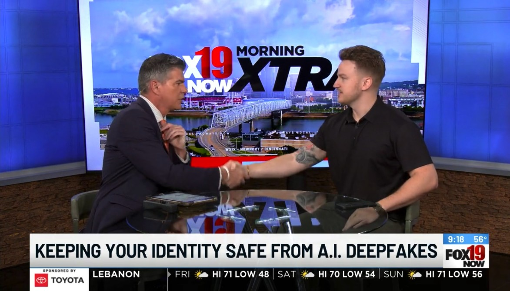

### 2026 - Fox19 Cincinnati - How to Protect Yourself from Deepfakes

  

I joined Fox19 Cincinnati on Morning Xtra for a segment titled "Keeping Your Identity Safe from A.I. Deepfakes." AI can now clone a voice from a few seconds of audio and fake a convincing video call, so scammers are using it to impersonate family members, bosses and even banks. The goal was to give viewers simple habits that work no matter how good the fake gets.

A few of the tips we covered:

- **Set a family safe word.** If "your grandson" calls in a panic asking for money, ask for the word. A cloned voice won't know it.
- **Verify through a second channel.** Hang up and call the person back on the number you already have, or text someone who's with them, before you send money or share information.
- **Slow down when it's urgent.** Pressure and secrecy ("don't tell anyone", "it has to be right now") are the biggest red flags, whether the voice sounds real or not.
